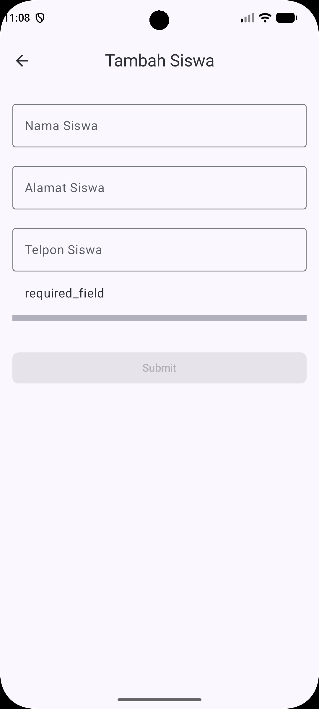
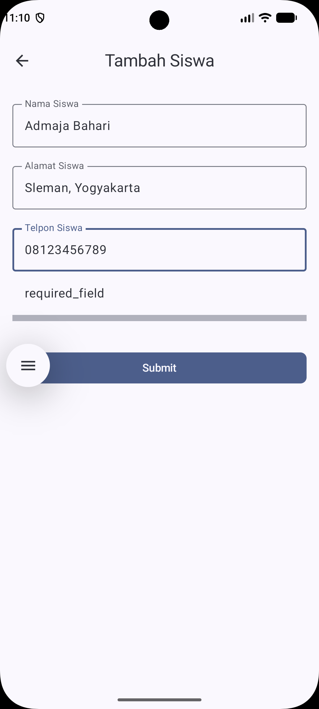
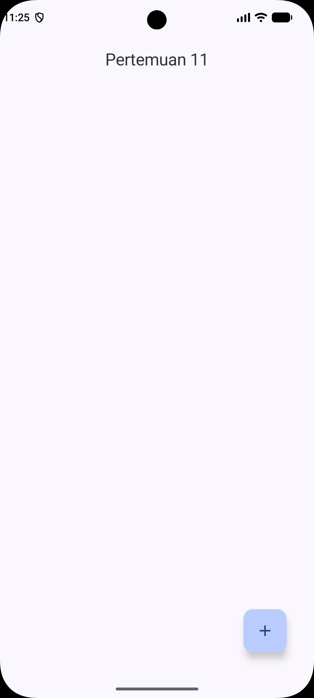
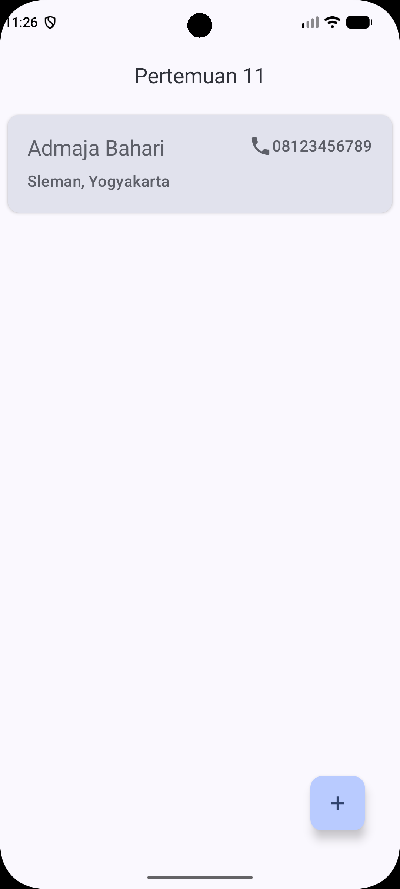
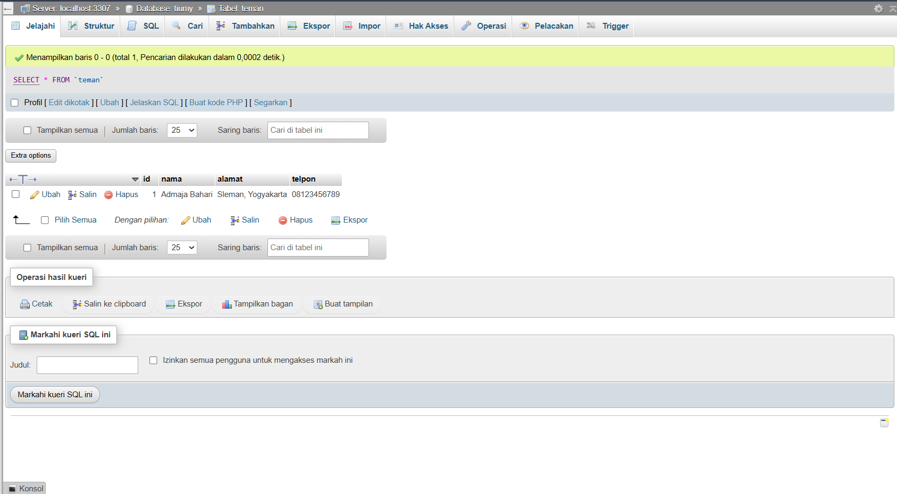

# Pertemuan 11 - Aplikasi Data Siswa (REST API)

Aplikasi Android dengan Jetpack Compose untuk menampilkan dan menambah data siswa. Data dikirim ke database MySQL melalui API PHP.

**Nama:** Admaja Bahari

## Fitur

- Menampilkan daftar siswa dari database
- Menambah data siswa melalui form
- Tombol Submit aktif setelah semua kolom terisi
- Tombol Retry saat data gagal dimuat

## Teknologi

- Kotlin dan Jetpack Compose (Material 3)
- Navigation Compose
- ViewModel
- Retrofit dan Kotlinx Serialization
- PHP dan MySQL (XAMPP)

## Struktur Folder

```
com.example.pertemuan11
├── apiservice      # Interface endpoint API
├── modeldata       # Model DataSiswa
├── repositori      # Repository dan konfigurasi Retrofit
├── uicontroller    # Navigasi dan route
├── view            # Halaman Home, Entry, dan Top App Bar
└── viewmodel       # HomeViewModel, EntryViewModel, factory
```

## API

Base URL: `http://10.0.2.2/umyTI/` (localhost komputer dilihat dari emulator)

| Method | Endpoint | Fungsi |
|--------|----------|--------|
| GET | `bacaTeman.php` | Mengambil daftar siswa |
| POST | `insertTM.php` | Menambah data siswa |

File PHP disimpan di `C:\xampp\htdocs\umyTI\` dan tidak termasuk dalam repository ini.

## Database

Database `tiumy`, tabel `teman`:

```sql
CREATE DATABASE tiumy;
USE tiumy;

CREATE TABLE teman (
    id INT(11) NOT NULL AUTO_INCREMENT PRIMARY KEY,
    nama VARCHAR(255) NOT NULL,
    alamat VARCHAR(255) NOT NULL,
    telpon VARCHAR(255) NOT NULL
);
```

## Cara Menjalankan

1. Nyalakan Apache dan MySQL di XAMPP.
2. Buat database dan tabel seperti di atas.
3. Letakkan file PHP di `htdocs/umyTI`. Jika MySQL tidak memakai port 3306, tambahkan nomor port pada `mysqli_connect`.
4. Buka `http://localhost/umyTI/bacaTeman.php` untuk memastikan API berjalan.
5. Jalankan aplikasi di emulator Android.

## Tampilan Aplikasi

| Form Kosong | Form Terisi |
|:---:|:---:|
|  |  |

| Daftar Masih Kosong | Data Berhasil Ditambahkan |
|:---:|:---:|
|  |  |

## Bukti Data Masuk ke Database

Data yang diinput dari aplikasi tersimpan di tabel `teman` (phpMyAdmin):


